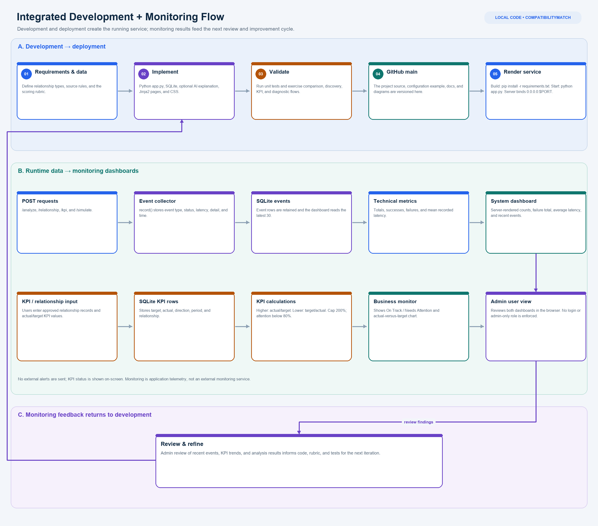
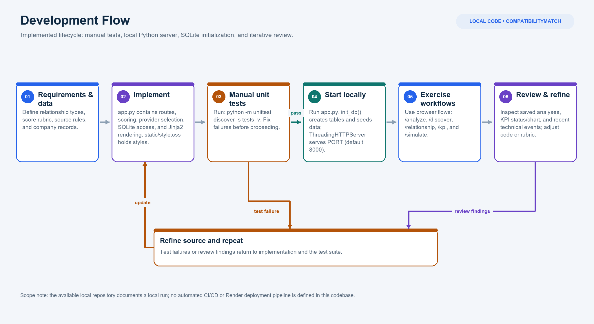
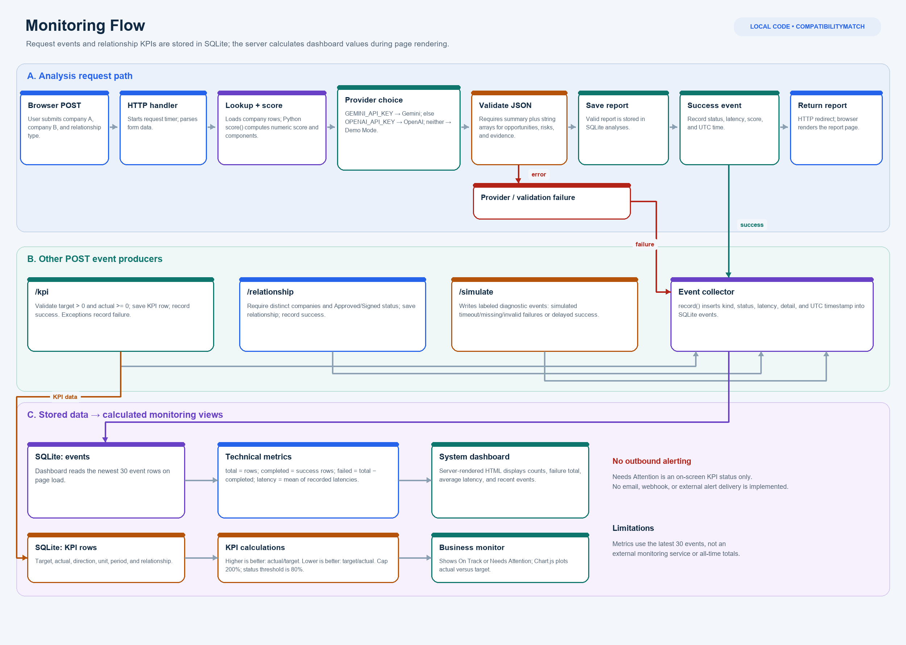

# CompatibilityMatch AI
## Saudi business partnership and investment intelligence MVP

A locally runnable, Arabic RTL demonstration of deterministic compatibility analysis, candidate discovery, Gemini API (preferred) or optional OpenAI explanations, and relationship KPI monitoring.

### Run on Windows

1. Install Python 3.10+.
2. In this directory run `py -m venv .venv`, then `.venv\Scripts\Activate.ps1`.
3. Run `py -m pip install -r requirements.txt`.
4. For live Gemini explanations, set `GEMINI_API_KEY` in your environment (obtain the key in Google AI Studio). Optionally set `GEMINI_MODEL`; default is `gemini-3.6-flash`. PowerShell example: `$env:GEMINI_API_KEY = "your-key"`.
5. Run `py app.py`; open http://127.0.0.1:8000.
6. Run tests: `py -m unittest discover -s tests -v`.

The app uses SQLite and creates the database and a fictional demo partnership on first launch. Set `PORT` or `CM_DATABASE` to override defaults. Gemini is used when `GEMINI_API_KEY` is set; otherwise `OPENAI_API_KEY` enables the OpenAI fallback. If neither is configured, the report is clearly labeled Demo Mode. API keys are read from environment variables; the app does not load `.env` automatically.

### What works

- Company comparison for strategic partnerships, directional equity investment, and joint ventures.
- Transparent deterministic rubric and candidate rankings over the verified local records.
- Relationship performance records, monthly KPI inputs, direction-aware achievement, and actual versus target chart.
- Technical event log with request counts, successes, failures and average latency, plus diagnostic event simulation.
- CSV import template endpoint (`/api/companies.csv`) and health endpoint (`/api/health`).
- Gemini `generateContent` integration with JSON response format and validation; optional OpenAI fallback; provider errors are recorded as failed technical events.

### Data provenance

Sample relationship data is fictional and labeled simulated. Financial fields are NULL. The verified-company selector currently includes ACWA Power and stc only, with official source URLs in the database. No broad Tadawul coverage is claimed.

### Scoring v1

Partnership: sector complementarity 55% and product complementarity 45%. Investment (A considers B): strategic suitability 40% and availability of B financial data 60%; missing data receives zero for that component and the UI discloses the limitation. JV: resource complementarity 40%, product complementarity 35%, financial data availability 25%. Scores are prioritization aids, not expected returns or investment advice. Direction matters; swap A and B to analyze the reverse investment case. Confidence is separately reported as limited where financial data is absent.

KPI achievement is actual/target for higher-is-better, and target/actual for lower-is-better (capped at 200%). Example statuses use a configurable-in-code 80% attention boundary. Actual cause of variance is not inferred.

### AI evaluation and review

Human reviewer worksheet: for each generated sentence, mark (1) factual claim or interpretation, (2) source evidence present, (3) supported / unsupported / not verifiable, (4) hallucinated detail, (5) useful and appropriately cautious (1-5). Save reviewer, analysis ID, prompt/model version, and adjudication. This repository does not claim benchmark accuracy.

### Architecture and trade-offs

See `docs/architecture.md` and `docs/diagrams.md`. For a dependency-light local MVP, request routing uses Python's standard-library HTTP server, SQLite, and Jinja2 templates rather than Flask/SQLAlchemy. The Gemini REST request is made directly with Python's standard library; no API SDK is required.

### Technical diagrams

### Limits

No market-wide Tadawul coverage, real financial statements, private partnership synchronization, valuation/ownership records, authentication, CSV upload, token/cost telemetry, or production deployment. Relationship activation is represented by manually recorded status; the sample relationship is explicitly simulated. Chart.js is loaded from CDN. Financial ratios are not computed without source data.
