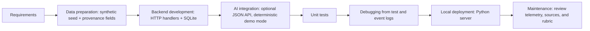
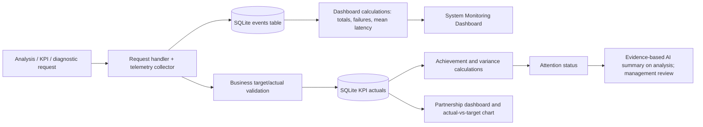

# Implemented technical diagrams

## Development flow

## Monitoring flow

Business status flow begins from a relationship recorded as approved/signed by the user; the seeded sample is explicitly marked simulated. The current UI treats KPI updates as user-entered measurements and does not infer causes.
