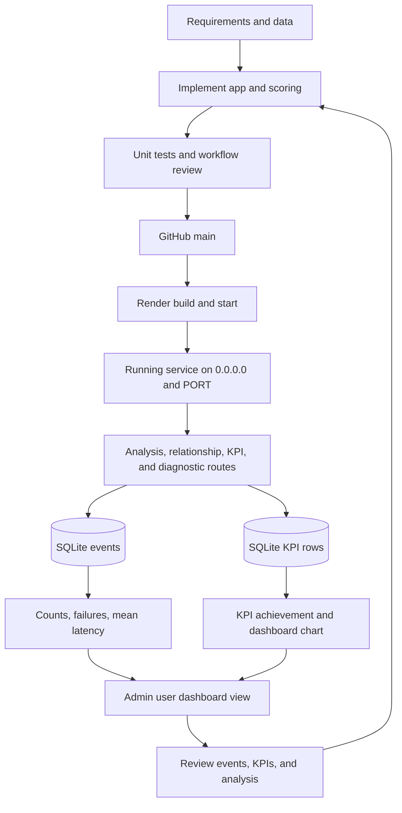
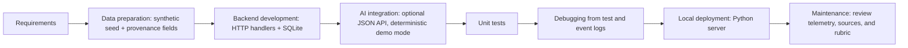
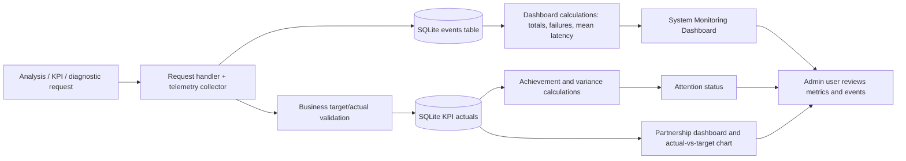

# Implemented technical diagrams

## Integrated development and monitoring flow

The admin user is shown as a dashboard viewer. The current application does not enforce login or admin-only permissions.

## Development flow

## Monitoring flow

Business status flow begins from a relationship recorded as approved/signed by the user; the seeded sample is explicitly marked simulated. The current UI treats KPI updates as user-entered measurements and does not infer causes. The admin user in this diagram is an operational viewer only: the app currently has no login, role checks, or admin-only authorization.
